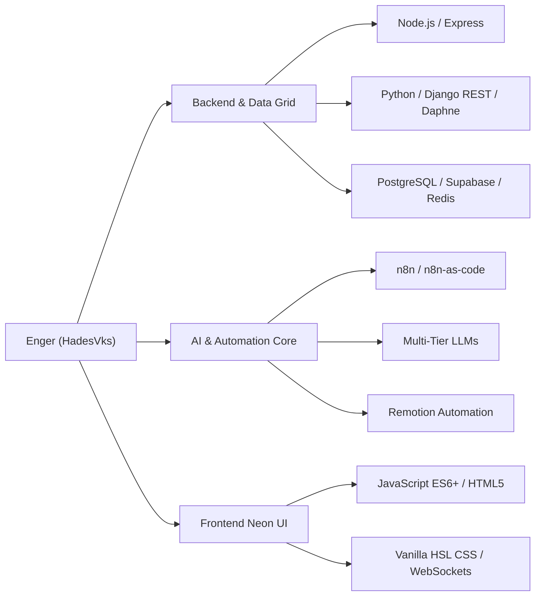

<div align="center">

```
  ██████╗  ██████╗ ███████╗    ███╗   ██╗███████╗██████╗ ███╗   ██╗
  ██╔══██╗██╔═══██╗██╔════╝    ████╗  ██║██╔════╝██╔══██╗████╗  ██║
  ██████╔╝██║   ██║███████╗    ██╔██╗ ██║█████╗  ██║  ██║██╔██╗ ██║
  ██╔══██╗██║   ██║╚════██║    ██║╚██╗██║██╔══╝  ██║  ██║██║╚██╗██║
  ██║  ██║╚██████╔╝███████║    ██║ ╚████║███████╗██████╔╝██║ ╚████║
  ╚═╝  ╚═╝ ╚═════╝ ╚══════╝    ╚═╝  ╚═══╝╚══════╝╚═════╝ ╚═╝  ╚═══╝
```

# ⚡ ENGER | HADESVKS 🇩🇴
### 🕹️ **AI AUTOMATION ARCHITECT & FULL-STACK CYBER ENGINEER** 🕹️

[](https://github.com/HadesVks)
[](https://github.com/HadesVks)


---

<p align="center">
  
</p>

</div>

---

## 🕶️ SYSTEM DIAGNOSTICS & USER PROFILE

Greetings, Traveler of the Digital Matrix. I am **Enger (HadesVks)**, a Senior Software Architect specializing in **High-Performance AI Automation Pipelines, Real-Time Web Architecture, and Next-Gen iGaming Systems**.

Driven by 80s Synthwave aesthetics and cutting-edge software engineering, I design decoupled, resilient server systems powered by multi-tier LLMs, ASGI WebSockets, and headless video rendering automation.

- 🏙️ **Primary Base:** Dominican Republic 🇩🇴
- ⚡ **Core Domain:** AI Workflow Orchestration (`n8n-as-code`), High-Concurrency Web Architecture & Full-Stack Systems.
- 🕹️ **Current Quest:** Building next-level automated AI pipelines and high-velocity live platforms.

---

## 🕹️ FEATURED CYBER PROJECTS

### 🏛️ 1. [Hades House RD — Official Sportsbook & Casino](https://hadesvks.github.io/HadesHouse/)
> **Real-Time Sports Betting & Virtual Casino Platform**
- ⚡ **Frontend Engine:** HTML5, Custom 80s HSL Design System, Glassmorphism, Neon Animations, ES6+ JS.
- 📡 **Live Data Grid:** Direct stream from **TheSportsDB v3 API** covering LIDOM Baseball, MLB, UEFA Champions League, and NBA.
- 💳 **Payment Gateway Integration:** Instant deposits and withdrawals via Credit/Debit Cards, Dominican Bank Transfers (Banco Popular / Banreservas), and TRC-20 USDT Crypto.
- ⚙️ **Backend Core:** Production-ready **Django REST + Daphne (ASGI WebSockets) + PostgreSQL + Redis Broker**.

### 🤖 2. Bless.Bot — Multi-Tier AI WhatsApp Bot
> **Intelligent Conversational Agent Powered by Multi-Tier Fallback AI**
- 🧠 **Multi-Tier Cascade:** Resilient 4-Level AI routing engine: Gemini 2.5 Flash (Tier 1) ➔ Groq Llama3-70B (Tier 2) ➔ OpenRouter DeepSeek (Tier 3) ➔ Local Phi-4-mini (Tier 4).
- 🔒 **Security Matrix:** Custom admin command locks, RAM/CPU safeguards, and authentic local personality.

### 🎬 3. Headless Video Automation Pipeline
> **Automated Video Rendering Engine Built on Remotion & n8n**
- 📽️ **Multi-Broll Engine:** Dynamic video asset stitching with microsecond audio-visual synchronization (AAC 320kbps).
- ⚡ **Multi-Core Overdrive:** High-fidelity 60 FPS video generation orchestrated by declarative Bash/Fish scripts.

---

## 🛠️ CYBERNETIC TECH STACK



### 💾 Core Technologies


### 🗄️ Database, Broker & Cloud Infrastructure


---

## 🎰 RETRO ARCADE STATS

<div align="center">
  
  
</div>

<div align="center">
  
</div>

---

## 📡 CONNECT TO THE GRID

- 🌐 **Live Platform:** [Hades House RD](https://hadesvks.github.io/HadesHouse/)
- 💻 **GitHub Main Frame:** [github.com/HadesVks](https://github.com/HadesVks)
- ⚡ **Core Discipline:** High-Performance Automation, AI Multi-Tier Architecture & Full-Stack Systems.

<div align="center">
  <br>
  <sub><i>"PRESS START — Coding high-speed software with 80s retro precision." — Enger (HadesVks) 🇩🇴</i></sub>
</div>
