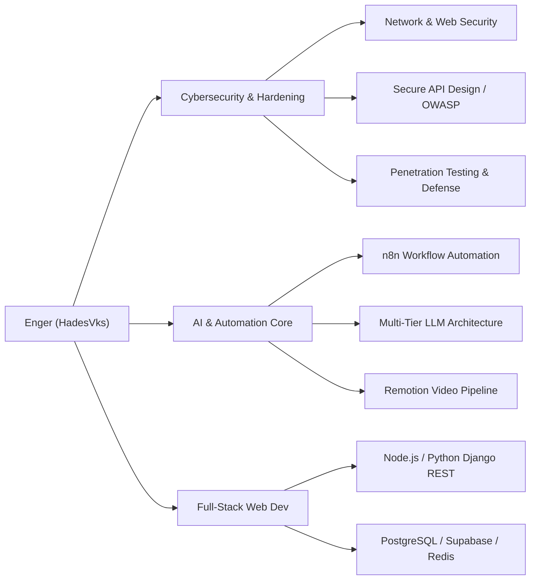

<div align="center">

```
  ██████╗  ██████╗ ███████╗    ███╗   ██╗███████╗██████╗ ███╗   ██╗
  ██╔══██╗██╔═══██╗██╔════╝    ████╗  ██║██╔════╝██╔══██╗████╗  ██║
  ██████╔╝██║   ██║███████╗    ██╔██╗ ██║█████╗  ██║  ██║██╔██╗ ██║
  ██╔══██╗██║   ██║╚════██║    ██║╚██╗██║██╔══╝  ██║  ██║██║╚██╗██║
  ██║  ██║╚██████╔╝███████║    ██║ ╚████║███████╗██████╔╝██║ ╚████║
  ╚═╝  ╚═╝ ╚═════╝ ╚══════╝    ╚═╝  ╚═══╝╚══════╝╚═════╝ ╚═╝  ╚═══╝
```

# ⚡ ENGER | HADESVKS 🇩🇴
### 🛡️ **CYBERSECURITY STUDENT & FULL-STACK AI ARCHITECT** 🛡️

[](https://github.com/HadesVks)
[](https://github.com/HadesVks)


---

<p align="center">
  
</p>

</div>

---

## 🕶️ CYBER DIAGNOSTICS & OPERATOR PROFILE

Greetings, Grid Operator. I am **Enger (HadesVks)**, a **Cybersecurity Student from the Dominican Republic 🇩🇴** and Full-Stack AI Engineer passionate about **Defensive Cyber Architecture, Ethical Hacking, Secure Web Engineering, and AI Automation**.

My focus bridges high-speed software development with cyber defense—engineering systems hardened against vulnerabilities (OWASP Top 10, CORS Bypasses, Sanitization, API Encryption) while building automated pipelines and real-time platforms.

- 🏙️ **Location:** Dominican Republic 🇩🇴
- 🎓 **Academic Discipline:** Cybersecurity & Information Security
- 🛡️ **Cyber Focus:** Penetration Testing, Secure Coding, Vulnerability Auditing, API Hardening & Network Security
- 🕹️ **Current Quest:** Mastering Offensive & Defensive Cyber Operations while engineering AI systems.

---

## 🕹️ FEATURED CYBER PROJECTS

### 🏛️ 1. [Hades House RD — Secure Sportsbook & Casino Platform](https://hadesvks.github.io/HadesHouse/)
> **Real-Time Sportsbook Engine Hardened for Security & High Concurrency**
- 🛡️ **Cyber Security Specs:** CORS-resilient API Sanitization, XSS & SQLi Defense, SSL 256-bit Gateways, Session Cryptography.
- ⚡ **Frontend Engine:** Custom 80s HSL Design System, Glassmorphism, ES6+ JS.
- 💳 **Payment Gateway Integration:** Instant deposit/withdrawal center covering Credit/Debit Cards, Dominican Bank Transfers (Popular / Banreservas), and TRC-20 USDT Blockchain.
- ⚙️ **Backend Core:** **Django REST + Daphne (ASGI WebSockets) + PostgreSQL + Redis Broker**.

### 🤖 2. Bless.Bot — Multi-Tier AI WhatsApp Bot
> **Intelligent WhatsApp Bot Powered by Multi-Tier Fallback AI**
- 🧠 **Resilient Architecture:** 4-Tier AI Fallback (Gemini 2.5 Flash ➔ Groq Llama3-70B ➔ OpenRouter DeepSeek ➔ Local Phi-4-mini).
- 🔒 **Security Matrix:** Admin command locks (`.lockcmd`), memory leak mitigation, and local identity safeguards.

### 🎬 3. Headless Video Automation Pipeline
> **Automated Video Rendering Engine Built on Remotion & n8n**
- 📽️ **Multi-Broll Engine:** Dynamic asset stitching with microsecond audio-visual synchronization (AAC 320kbps).
- ⚡ **Multi-Core Overdrive:** High-fidelity 60 FPS video generation orchestrated by declarative Fish/Bash scripts.

---

## 🛡️ CYBERSECURITY & TECH MATRIX



### 🛡️ Cyber & Security Stack


### 💻 Full-Stack Languages & Data


---

## 🎰 RETRO ARCADE STATS

<div align="center">
  
  
</div>

<div align="center">
  
</div>

---

## 📡 CONNECT TO THE CYBER GRID

- 🌐 **Live Platform:** [Hades House RD](https://hadesvks.github.io/HadesHouse/)
- 💻 **GitHub Mainframe:** [github.com/HadesVks](https://github.com/HadesVks)
- 🛡️ **Cyber Focus:** Cybersecurity Student, Defensive Web Architecture & AI Automation Systems.

<div align="center">
  <br>
  <sub><i>"DEFEND THE GRID — Engineering secure & automated digital infrastructure." — Enger (HadesVks) 🇩🇴</i></sub>
</div>
