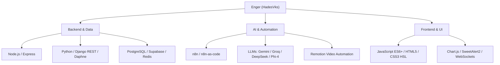

# ⚡ ENGER | HADESVKS 🇩🇴
### **AI Automation Architect & Senior Full-Stack Engineer**

---

  

---

## 👨‍💻 Sobre Mí

¡Hola! Soy **Enger (HadesVks)**, desarrollador e ingeniero de software especializado en la **construcción de infraestructuras de alta disponibilidad, sistemas de automatización con IA y plataformas iGaming de alto rendimiento**. 

Mi enfoque está centrado en crear soluciones resilientes, arquitecturas de IA multitier (Cloud & Local LLMs) y motores de renderizado audiovisual automatizados en tiempo real.

- 🚀 **Proyectos Activos:** Creador de [Hades House RD](https://hadesvks.github.io/HadesHouse/) (Sportsbook & Casino), **Bless.Bot** (WhatsApp Multi-AI Bot) y pipelines de automatización con **Remotion + n8n**.
- 🛠️ **Arquitectura de IA:** Diseñador de proxies de baja latencia con fallback multinivel (Gemini 2.5 Flash ➔ Groq Llama3-70B ➔ OpenRouter ➔ Phi-4 Local).
- ⚡ **Workflow & DevOps:** Orquestador de flujos de trabajo con **n8n-as-code**, contenedores Docker, WebSockets y bases de datos relacionales en la nube.
- 🇩🇴 **Orgullosamente de:** República Dominicana.

---

## 🚀 Proyectos Destacados

### 🏛️ 1. [Hades House RD — Sportsbook & Casino Oficial](https://hadesvks.github.io/HadesHouse/)
> **Casa de Apuestas Deportivas & Casino Virtual en Tiempo Real**
- ⚡ **Frontend:** HTML5, Vanilla CSS (Design System HSL, Glassmorphism, Neón), JavaScript ES6+.
- 📡 **APIs & Data:** Conexión en vivo a **TheSportsDB v3 API**, marcadores de la LIDOM, MLB, UEFA Champions League y NBA.
- 💳 **Pasarelas de Pago:** Módulo real de depósitos y retiros mediante Tarjetas de Crédito/Débito, Transferencia Bancaria RD (Banco Popular / Banreservas) y USDT Cripto (Red TRC-20).
- ⚙️ **Backend:** Paquete de producción en **Django REST Framework + Daphne (ASGI) + PostgreSQL + Redis**.

### 🤖 2. Bless.Bot — WhatsApp AI Bot Multi-Tier
> **Bot Inteligente con Arquitectura de Inteligencia Artificial en Cascada**
- 🧠 **Multi-Tier Fallback:** Resiliencia en respuesta utilizando Gemini Flash (Tier 1) ➔ Groq Llama3-70B (Tier 2) ➔ OpenRouter DeepSeek (Tier 3) ➔ Phi-4-mini Local (Tier 4).
- 🔒 **Gestión de Comandos:** Administración de permisos, candados de CPU/RAM y respuestas dinámicas con personalidad dominicana casual.

### 🎬 3. Automated Video Generation Pipeline
> **Sistema de Renderizado Automatizado de Contenidos de Video con Remotion & n8n**
- 📽️ **Multi-Broll Engine:** Descarga y mezcla dinámica de secuencias de video con sincronización exacta de audio AAC y subtítulos.
- ⚡ **Concurrencia Multi-Core:** Renderizado a 60 FPS acelerado mediante scripts optimizados en Bash/Fish Shell.

---

## 🛠️ Stack Tecnológico

### 💻 Lenguajes & Frameworks
p

### 🗄️ Bases de Datos, Caché & Cloud

---

## 📈 GitHub Analytics

  
  

  

---

## 📬 Conéctate Conmigo

- 🌐 **Web de Apuestas en Vivo:** [Hades House RD](https://hadesvks.github.io/HadesHouse/)
- 💻 **Repositorios en GitHub:** [github.com/HadesVks](https://github.com/HadesVks)
- ⚡ **Especialidad:** Automatización de Procesos de Alto Rendimiento, IA Multimodal & iGaming.

   
  <i>"Construyendo software rápido, confiable y automatizado." — Enger (HadesVks) 🇩🇴</i>

